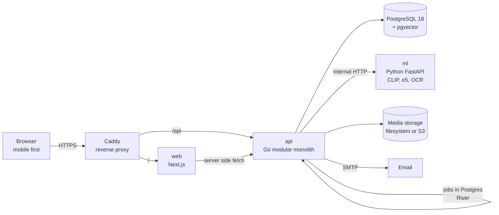

# SimpanUGM

**Sistem Informasi Manajemen Penemuan dan Pengembalian Barang, Universitas Gadjah Mada.**

A campus lost and found platform. People report what they lost and what they found, an
AI matching engine ranks the most likely pairs from photos, descriptions, location and
time, and campus security officers verify ownership before anything is handed back. The
AI ranks, people decide.

> Status: **Sprint 4 complete, v1.0.0 automated readiness achieved.** `make dev` starts the whole stack:
> Go API with full accounts, master data, reports, photos, custody, semantic search, multimodal matching, review board,
> duplicate management, admin moderation, runtime settings, audit log, analytics, and observability;
> Next.js app for members, officers, and admins with hotspots map, operational trends, AI monitoring, and case clustering;
> FastAPI ML service with CLIP, e5 embeddings, OCR, HDBSCAN clustering, and learned fusion experiment;
> automated backup/restore scripts, Prometheus alert rules, Grafana dashboards, and production deploy artifacts.
> See [docs/project/project-plan.md](docs/project/project-plan.md).

## What it does

| For | SimpanUGM gives |
|---|---|
| Owners | A lost report in under three minutes with photo assisted filling, ranked candidates with a score breakdown, a claim flow, a handover code |
| Finders | A found report with an auto drafted description, instant hints that an owner may exist, guidance on where to hand the item in |
| Officers | A priority queue, a side by side review board, a verification checklist, custody inventory with retention countdown, handover by code |
| Admins | Accounts and master data, moderation, audit trail, hotspot analytics on a campus map, AI clustering and matching monitoring |

## Architecture at a glance



One public origin, cookie sessions, one database that also holds vectors and the job
queue, and a separate Python service only for inference. The reasoning behind each choice
is recorded in [docs/architecture/adr/](docs/architecture/adr/).

## Quickstart

Run the full local development stack from clone in under five minutes:

1. Clone the repository and enter the directory:
   ```bash
   git clone https://github.com/pisondev/simpanugm.git
   cd simpanugm
   ```
2. Generate local environment files:
   ```bash
   make env
   ```
3. Start all services, apply migrations, and load campus seed master data:
   ```bash
   make dev
   ```
4. Access the web interface at `http://localhost:3000` (or `http://localhost` through Caddy reverse proxy) and Mailpit email inspector at `http://localhost:8025`.

### Running Verification Tests

Run the full validation suite locally:

```bash
# API unit and integration tests
cd api && go test -tags nodynamic ./...
go test -tags integration,nodynamic ./internal/server

# Web lint, typecheck, and unit tests
cd web && npm run typecheck && npm run lint && npm test

# ML lint, formatting, typecheck, and tests
cd ml && uv run ruff check . && uv run mypy && uv run pytest
```

## Repository map

| Path | What lives there | Owner |
|---|---|---|
| [docs/](docs/) | Product, requirements, architecture, AI, UX, engineering, operations, project plan | all |
| [api/](api/) | Go core API, background workers, migrations | Pison |
| [web/](web/) | Next.js frontend for all four roles | Pison |
| [ml/](ml/) | Python inference service, offline evaluation harness | Irfan |
| [data/](data/) | Master data seeds, evaluation dataset pipeline, analytics queries | Axelle |
| [deploy/](deploy/) | Docker Compose, Caddy, environment templates, backup scripts | Pison |

## Documentation

Start at [docs/README.md](docs/README.md). The short path for a new reader:

1. [Product requirements](docs/product/prd.md), what and why.
2. [Software requirements](docs/requirements/srs.md), every requirement with an id.
3. [Architecture overview](docs/architecture/overview.md), how the parts fit.
4. [Matching engine](docs/ai/matching-engine.md), the AI core.
5. [Testing strategy](docs/engineering/testing-strategy.md), test levels and journeys.
6. [Traceability matrix](docs/requirements/traceability.md), user stories to verification.
7. [Release checklist](docs/operations/release-checklist-v1.0.0.md), PRD section 9 audit.
8. [Operations runbook](docs/operations/runbook.md), incident response procedures.
9. [Project plan](docs/project/project-plan.md), who builds what and when, and the [demo first plan](docs/project/demo-first-plan.md), what the remaining time goes to.

## Tech stack

Next.js 16 with TypeScript and Tailwind CSS, Go 1.26 with chi, pgx, sqlc and River,
PostgreSQL 18 with pgvector, Python 3.12 with FastAPI, PyTorch and sentence-transformers.
Versions and the reason for every library: [docs/engineering/tech-stack.md](docs/engineering/tech-stack.md).

## Team

Grup A, PACS262527 Rekayasa Model Kecerdasan Artifisial, Semester Gasal 2026/2027.

| Member | Role |
|---|---|
| Pison Golda | Software Engineer, tech lead |
| Irfan Fadilah Rafif | AI Engineer |
| Axelle Chandra | Data Engineer |

How we work together: [CONTRIBUTING.md](CONTRIBUTING.md).
