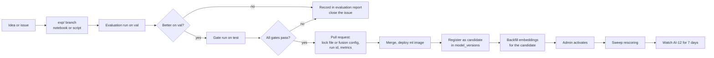

# Model Lifecycle | SimpanUGM

How a model or a fusion configuration goes from an idea to production, how it is
identified everywhere, and how it is rolled back. The same rules apply to all eight
components: `image_encoder`, `xmodal_text_encoder`, `text_encoder`, `ocr`,
`category_classifier`, `colour_extractor`, `brand_matcher`, `fusion`.

## 1. Identity of a version

A version is the tuple that fully determines an output.

| Component kind | Identity |
|---|---|
| Neural encoder | Hugging Face model id, exact revision hash, preprocessing version, output dimension |
| OCR | library version, language set, input size |
| Rule based extractor | `ml` package version and the hash of its config file |
| Fusion | the JSON document of matching-engine section 7.1, identified by its `id` and SHA-256 |

Versions are rows in `model_versions` (data-model section 4.5) with the identity, the
evaluation run id and its gate metrics, `status` (`candidate`, `active`, `retired`) and the
activation history. Exactly one version per component is `active`, enforced by a partial
unique index.

Naming: `<component>-<short-name>-<yyyy.mm.n>`, for example
`image_encoder-clipb32-2026.11.0`, `fusion-linear-2026.11.0`.

## 2. Where versions are recorded

| Artefact | Records |
|---|---|
| `ml/models.lock.json` | the model id and revision hash `ml` loads per component |
| `GET /v1/models` | what `ml` actually loaded, checked by `api` at start against the active rows |
| `image_embeddings`, `report_text_embeddings`, `image_attributes` | `model_version_id` per row |
| `matches` | the version of every component that fed it plus the fusion version (NFR-REPRO-03) |
| Evaluation runs | the lock file, the fusion document, the dataset hash, the git commit |

If `api` finds that `ml` serves a revision different from the active row, readiness fails
with `model_version_mismatch` and matching jobs pause. This prevents vectors of two
different models from being compared.

## 3. Path to production

| Step | Rule |
|---|---|
| Experiments | live on `exp/<topic>` branches. Notebooks may explore, but anything that produces a gate number runs from `ml/eval/` |
| Gate run | uses `test` once per candidate. A candidate that fails is not retried with tweaks on `test`; the tweaks go back to `val` |
| Pull request | must include the run id, the gate table and the comparison with the active version. Labelled `contract` when an embedding dimension changes |
| Backfill before activation | new encoder versions compute embeddings for all open reports while the old version stays active. Matching keeps using the active version until the switch. The backfill job reports progress in AI-12 |
| Activation | an administrator action (FR-ADMIN-06), audited, which marks the previous version `retired` and enqueues the sweep |
| Watch period | 7 days of AI-12 with attention to tier precision, dismiss rate and score PSI |

A fusion change needs no backfill, because it only reweights stored components. It still
needs a gate run and an activation.

## 4. Rollback

| Situation | Action | Time |
|---|---|---|
| Fusion version misbehaves | Activate the previous fusion version in the admin page. Sweep rescoring runs | minutes |
| Encoder version misbehaves, previous embeddings still stored | Activate the previous encoder version. Its embeddings are still in the tables for open reports, because old versions are kept until the watch period ends | minutes |
| Encoder version misbehaves after old embeddings were deleted | Redeploy the previous `ml` image, run `ai.backfill` for the previous version, activate | under an hour for current volumes |

Embeddings of a retired version are deleted 14 days after retirement, by a periodic job,
and never sooner than the end of the watch period.

## 5. Serving

| Aspect | Rule |
|---|---|
| Image | `ml` is one OCI image with code only. Weights are downloaded on first start into the `ml-models` volume, verified against the revision hash, and reused |
| Startup | `/readyz` returns 503 until every model is loaded and a warm up inference has run |
| Threads | `torch.set_num_threads(2)`, leaving CPU for `api` and PostgreSQL |
| Optional speedup | ONNX Runtime export of the two CLIP encoders is a v1.1 option, accepted only if the cosine between ONNX and PyTorch outputs is at least 0.9999 on the fixture |
| Resource limits | 3 GB memory limit in Compose, which covers all models with headroom |

## 6. Monitoring and retraining triggers

AI-12 is the monitor. These conditions open an issue labelled `ml`:

| Trigger | Threshold |
|---|---|
| Score PSI against the previous 4 weeks | above 0.2 for two consecutive weeks |
| High tier precision from outcomes | below 0.80 with at least 20 outcomes in the period |
| Owner dismiss rate of high tier | above 30 percent with at least 20 dismissals |
| Online Recall@5 | below 0.70 with at least 20 returns in the period |
| Category suggestion acceptance | below 60 percent |
| Embedding coverage | below 98 percent for more than an hour |

"Retraining" here means recalibrating bands, weights and thresholds on the newest labels,
or training the learned fusion again. The encoders are used pretrained. Fine tuning them
is out of scope for v1.0 and would need its own evaluation plan.

## 7. Documentation per version

Initial model cards for the locked foundation models are maintained in
[model-cards.md](model-cards.md). Each activated production version gets a model card section
in `docs/ai/evaluation-report.md`: identity, intended use, data it was evaluated on, gate
metrics with confidence intervals, known weaknesses from the error analysis, and the date
it was activated and retired.
