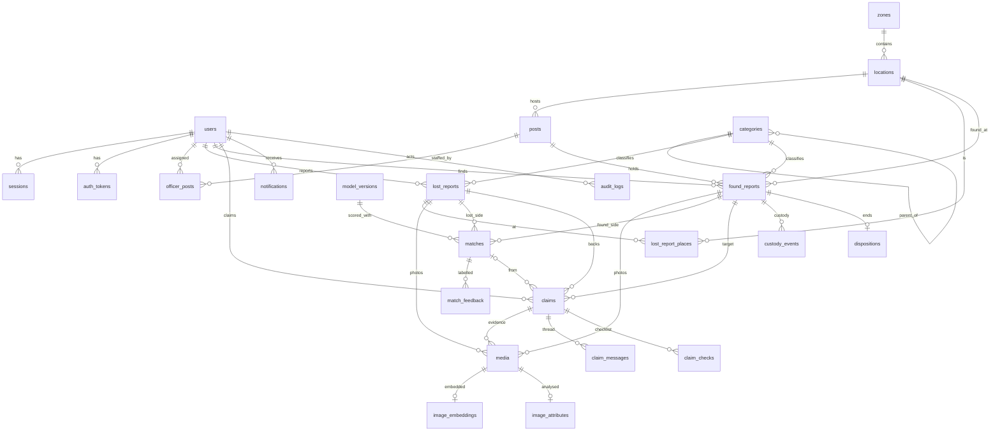

# Data Model | SimpanUGM

| | |
|---|---|
| Owner | Pison Golda |
| Reviewer | Axelle Chandra |
| Database | PostgreSQL 18 with `vector` (pgvector 0.8), `citext`, `pg_trgm`, `unaccent` |
| Migrations | `api/migrations/`, goose, numbered, every migration has a working down step |

## 1. Conventions

| Topic | Rule |
|---|---|
| Names | `snake_case`, plural table names, singular column names, foreign keys `<entity>_id` |
| Keys | `id uuid primary key`, UUIDv7 generated in Go. Append only logs use `bigint generated always as identity` |
| Enumerations | `text` with a `CHECK` constraint, so adding a value is one migration without type juggling |
| Time | `timestamptz`, always UTC. Never `timestamp` without zone |
| Audit columns | `created_at timestamptz not null default now()`, `updated_at` maintained by the application |
| Concurrency | `version integer not null default 1` on every aggregate that users edit concurrently: reports, claims, matches, users |
| Soft deletion | Only where history matters (`users.deleted_at`, `media.deleted_at`). Everything else is closed by status |
| Money, scores | Scores `numeric(5,4)`. No money in this system |
| Text limits | Lengths from the SRS enforced twice: by validation in `api` and by `CHECK (char_length(x) between a and b)` |
| JSON | `jsonb` only for data read as a whole and never filtered by, such as answers, configs and score explanations |

`immutable_unaccent(text)` is a SQL wrapper declared `IMMUTABLE` around `unaccent`, so it can
be used in index expressions. Search keys are `lower(immutable_unaccent(...))`.

## 2. Entity relationship diagram

## 3. Database roles

| Role | Privileges | Used by |
|---|---|---|
| `simpan_owner` | owns the schema, DDL | `simpan migrate` only |
| `simpan_app` | `SELECT`, `INSERT`, `UPDATE`, `DELETE` on application tables. On `audit_logs` only `SELECT` and `INSERT` (FR-AUDIT-02) | `api`, `worker` |
| `simpan_readonly` | `SELECT` on the analytics views and model metrics | Grafana |

## 4. Tables

Types are abbreviated: `uuid`, `text`, `int`, `smallint`, `bool`, `tstz` for `timestamptz`,
`num` for `numeric(5,4)`, `jsonb`, `vector(n)`. `?` marks a nullable column.

### 4.1 Accounts

**users**

| Column | Type | Notes |
|---|---|---|
| id | uuid | |
| email | citext | unique |
| full_name | text | 2 to 100 |
| nim_nip | text? | letters, digits, dots, slashes and spaces, up to 30, for example `24/543770/PA/23107` |
| phone | text? | `+62` normalised, up to 20 |
| password_hash | text? | argon2id PHC string. Null until an invited user sets it |
| role | text | `member`, `officer`, `admin` |
| status | text | `pending_verification`, `active`, `suspended`, `deleted` |
| email_verified_at | tstz? | |
| claim_restricted_at | tstz? | BR-CLM-04 |
| privacy_version | text | accepted notice version |
| privacy_accepted_at | tstz | |
| last_login_at | tstz? | |
| deleted_at | tstz? | anonymised at, BR-RET-05 |
| version, created_at, updated_at | | |

Indexes: trigram GIN on `lower(immutable_unaccent(full_name))` for officer search.

**sessions**

| Column | Type | Notes |
|---|---|---|
| id | uuid | |
| user_id | uuid | FK users, cascade |
| token_hash | bytea | SHA-256 of the cookie token, unique |
| created_at, last_seen_at | tstz | |
| expires_at | tstz | absolute expiry |
| idle_expires_at | tstz? | officers and admins only |
| ip | inet | at creation |
| user_agent | text | truncated to 300 |
| revoked_at | tstz? | |

**auth_tokens**

| Column | Type | Notes |
|---|---|---|
| id | uuid | |
| user_id | uuid | FK users, cascade |
| purpose | text | `verify_email`, `reset_password`, `invite`, `change_email` |
| token_hash | bytea | unique |
| new_email | citext? | only for `change_email` |
| expires_at | tstz | |
| used_at | tstz? | single use |

**notification_preferences** `(user_id, event_group, channel)` primary key, `enabled bool`.
Groups: `matching`, `custody`, `claims_messages`, `found_updates`.

**idempotency_keys** `(user_id, key)` primary key, `endpoint`, `request_hash bytea`,
`resource_id uuid?`, `created_at`, `expires_at tstz`. The key is claimed inside the creating
transaction and stores the id of what was created, so a replay returns that resource. A
repeated key with a different request hash returns `422 idempotency_key_reused`.

### 4.2 Master data

**categories**

| Column | Type | Notes |
|---|---|---|
| id | uuid | |
| parent_id | uuid? | FK categories. Null for a parent |
| slug | text | unique among parents and unique among leaves, so a parent and its only leaf may share one, as `payung` does |
| name | text | Indonesian display name |
| sensitivity | text? | `normal`, `valuable`, `identity`. Required on leaves (`CHECK (parent_id is null or sensitivity is not null)`) |
| retention_days | int? | overrides BR-CUS-01 |
| verification_questions | jsonb | `[{key, question, required, check_hint}]` |
| clip_prompts | text[] | English prompts for zero shot |
| sort_order | int | |
| active | bool | |

**category_compatibility** `(category_a, category_b)` primary key with
`CHECK (category_a < category_b)`, `factor numeric(3,2) CHECK (factor between 0 and 1)`.

**zones** `id`, `slug` unique, `name`, `centroid_lat`, `centroid_lng` (double precision),
`active`.

**locations**

| Column | Type | Notes |
|---|---|---|
| id | uuid | |
| zone_id | uuid | FK zones |
| slug | text | unique |
| name | text | official name |
| aliases | text[] | student names, for example `{perpus, perpus pusat}` |
| kind | text | `building`, `outdoor`, `facility`, `transport`, `parking` |
| lat, lng | double precision | `CHECK` inside the campus bounding box from the seed |
| active | bool | |

Index: trigram GIN on `lower(immutable_unaccent(name || ' ' || array_to_string(aliases, ' ')))`.

**posts** `id`, `location_id` FK, `name`, `phone`, `opening_hours jsonb`
(`{"mon":[["07:00","16:00"]],...}`), `active`.

**officer_posts** `(user_id, post_id)` primary key, `assigned_at`, `assigned_by`.

**colours** `name` primary key, `hex`, `sort_order`. **brands** `name` primary key,
`aliases text[]`. **synonyms** `term` primary key, `expansion text`. All three are loaded
from `data/seed/` and also shipped to `ml` where it needs them.

### 4.3 Reports

**lost_reports**

| Column | Type | Notes |
|---|---|---|
| id | uuid | |
| code | text | unique, `LST-YYMM-NNNN` |
| reporter_id | uuid? | FK users. Null for proxy reports and after anonymisation |
| created_by | uuid? | FK users, the officer for proxy reports |
| proxy_name, proxy_phone | text? | walk in visitor |
| category_id | uuid | FK categories, must be a leaf |
| item_name | text | 3 to 80 |
| description | text | 20 to 1000 |
| private_details | text? | up to 500 |
| colours | text[] | at most 2, each in `colours` |
| brand | text? | up to 40 |
| lost_from, lost_until | tstz | `CHECK (lost_from <= lost_until and lost_until - lost_from <= interval '7 days')` |
| location_unknown | bool | true means no row in `lost_report_places` |
| location_note | text? | up to 200 |
| status | text | state machine L |
| close_reason | text? | `returned`, `found_by_owner`, `no_longer_needed`, `expired`, `duplicate`, `account_deleted` |
| closed_at | tstz? | `CHECK ((status = 'closed') = (close_reason is not null))` |
| duplicate_of | uuid? | FK lost_reports |
| hidden_at, hidden_reason | tstz?, text? | moderation |
| assist_outcome | jsonb? | AI-03 per field outcome |
| last_activity_at | tstz | BR-LST-02 |
| stale_reminded_at | tstz? | |
| anonymised_at | tstz? | BR-RET-01 |
| version, created_at, updated_at | | |

Indexes: `(reporter_id, status)`, `(status, lost_until)`, trigram GIN on
`lower(immutable_unaccent(item_name || ' ' || description))`.

**lost_report_places** `(lost_report_id, position)` primary key, `position smallint CHECK
(position between 1 and 3)`, `location_id uuid?`, `zone_id uuid?`,
`CHECK (num_nonnulls(location_id, zone_id) = 1)`.

**found_reports**

| Column | Type | Notes |
|---|---|---|
| id | uuid | |
| code | text | unique, `FND-YYMM-NNNN` |
| finder_id | uuid? | FK users. Null for proxy and after anonymisation |
| created_by | uuid? | FK users |
| proxy_finder_name | text? | optional for walk ins |
| category_id | uuid | leaf |
| item_name | text | 3 to 80 |
| description | text | 10 to 500, masked per BR-PRV-03 |
| hidden_details | text? | up to 500 |
| colours, brand | | as lost |
| found_at | tstz | |
| found_location_id | uuid | FK locations |
| location_note | text? | |
| custody_status | text | state machine C |
| custody_keep | boolean | the finder chose to keep the item, at most 48 hours, only for sensitivity `normal` (BR-FND-02) |
| intended_post_id | uuid? | FK posts |
| holding_post_id | uuid? | FK posts |
| storage_slot | text? | up to 40 |
| received_at, received_by | tstz?, uuid? | |
| retention_due_at | tstz? | `CHECK (custody_status <> 'in_custody' or (holding_post_id is not null and received_at is not null and retention_due_at is not null))` |
| retention_extended_at, retention_extension_reason | tstz?, text? | once only |
| overdue_flagged_at | tstz? | BR-FND-03 |
| status | text | state machine F |
| close_reason | text? | `returned`, `returned_directly`, `reported_in_error`, `disposed`, `duplicate` |
| close_note | text? | 5 to 500, required when the finder closes the report (BR-FND-05) |
| closed_at, duplicate_of, hidden_at, hidden_reason, assist_outcome, anonymised_at | | as lost |
| version, created_at, updated_at | | |

Indexes: `(finder_id, status)`, `(holding_post_id, custody_status, retention_due_at)`,
`(status, found_at)`, trigram GIN as lost.

**status_history**

| Column | Type | Notes |
|---|---|---|
| id | bigint identity | |
| entity_type | text | `lost_report`, `found_report`, `custody`, `claim`, `match` |
| entity_id | uuid | |
| from_status | text? | null on creation |
| to_status | text | |
| transition | text | the row id of the state machine table, for example `K6` |
| reason | text? | |
| actor_id | uuid? | null when `actor_kind = 'system'` |
| actor_kind | text | `user`, `system` |
| created_at | tstz | |

Index `(entity_type, entity_id, created_at)`.

**code_sequences** `(prefix, yymm)` primary key, `last_value int`. Allocated in the creating
transaction with `INSERT ... ON CONFLICT (prefix, yymm) DO UPDATE SET last_value =
code_sequences.last_value + 1 RETURNING last_value`.

### 4.4 Media

**media**

| Column | Type | Notes |
|---|---|---|
| id | uuid | |
| uploaded_by | uuid | FK users |
| purpose | text | `lost_report`, `found_report`. `claim_evidence` and `claim_id` arrive with claims in Sprint 3 |
| lost_report_id, found_report_id | uuid? | `CHECK (num_nonnulls(lost_report_id, found_report_id) <= 1)` |
| state | text | `staged` (processed, not yet attached), `ready` (attached), `deleted`. Variants are produced during the upload request, so there is no processing state |
| mime | text | `image/jpeg`, `image/png`, `image/webp` |
| width, height | int | after orientation |
| bytes | int | as received |
| sha256 | bytea | of the received bytes |
| phash | bigint | 64 bit perceptual hash of `display` |
| storage_keys | jsonb | `{"original": "...", "display": "...", "thumb": "...", "thumb_blur": "..."}` |
| position | smallint | display order |
| created_at, attached_at, deleted_at | tstz | |

Indexes: partial unique `(found_report_id, sha256)` and `(lost_report_id, sha256)` where
not deleted (BR-MED-03). `(state, created_at)` for the staging purge.

### 4.5 AI

**image_embeddings**

| Column | Type | Notes |
|---|---|---|
| media_id | uuid | FK media, cascade |
| model_version_id | uuid | FK model_versions |
| report_type | text | `lost`, `found`, copied for filtered search |
| report_id | uuid | copied for filtered search |
| embedding | vector(512) | L2 normalised |
| created_at | tstz | |

Primary key `(media_id, model_version_id)`. HNSW index on `embedding vector_cosine_ops`
with `m = 16, ef_construction = 64`. Queries set `hnsw.ef_search = 100` and
`hnsw.iterative_scan = relaxed_order`, and filter on `report_type`, `model_version_id` and
the pool condition.

**text_embeddings_e5** and **text_embeddings_clip**

| Column | Type | Notes |
|---|---|---|
| report_type | text | `lost`, `found` |
| report_id | uuid | |
| model_version_id | uuid | |
| embedding | vector(384) for e5, vector(512) for clip | |
| text_sha256 | bytea | of the matching text, skip re-embedding when unchanged |
| created_at, updated_at | tstz | |

Primary key `(report_type, report_id, model_version_id)`, HNSW cosine index each. A future
encoder with another dimension gets its own table through a migration.

**image_attributes** `media_id` primary key, `versions jsonb`, `category_scores jsonb`
(`[{slug, score}]`), `colours jsonb`, `visible_text text?` (masked), `brands jsonb`,
`created_at`.

**model_versions**

| Column | Type | Notes |
|---|---|---|
| id | uuid | |
| component | text | the eight components of model-lifecycle section 1 |
| name | text | unique, for example `fusion-linear-2026.11.0` |
| identity | jsonb | model id, revision, dimension, library versions |
| config | jsonb? | the fusion document for `fusion` |
| config_sha256 | bytea? | |
| eval_run_id | text? | |
| metrics | jsonb? | gate metrics |
| status | text | `candidate`, `active`, `retired` |
| activated_at, activated_by, retired_at | | |

Partial unique index on `(component)` where `status = 'active'`.

**matches**

| Column | Type | Notes |
|---|---|---|
| id | uuid | |
| lost_report_id, found_report_id | uuid | unique pair |
| visual_mode | text | `image`, `cross_modal`, `none` |
| s_visual, s_semantic, s_attr, s_text, s_location, s_time | num? | null when the component is missing |
| category_factor | num | |
| overall | num | |
| tier | text? | `high`, `medium`, `low`, null once a rescoring drops the pair below the storage floor |
| rank_for_lost, rank_for_found | smallint? | 1 to 10, only among pairs whose counterpart is still open |
| flags | text[] | for example `{name_hit}` |
| explanation | jsonb | the public facts behind the reason lines: distance, place, time relation, shared colour and brand, categories. Never words from hidden details or visible text (BR-VIS-04) |
| status | text | state machine M |
| owner_dismissed_at | tstz? | hides the pair from the owner and from `rank_for_lost` |
| notified_tier | text? | the tier the owner was last told about, BR-NTF-01 folds anything newer into the next notification |
| pinned_by, pinned_at | uuid?, tstz? | AI-07 |
| fusion_version_id | uuid | FK model_versions |
| component_versions | jsonb | per component version id |
| first_scored_at, scored_at | tstz | |
| version | int | |

Indexes: `(lost_report_id, status, overall desc)`, `(found_report_id, status, overall desc)`,
`(status, tier, scored_at)`.

**match_feedback** `id`, `match_id` FK, `actor_id`, `actor_role`, `verdict` (`relevant`,
`not_relevant`), `reason text?`, `created_at`.

**duplicate_links** `id`, `report_type`, `report_a`, `report_b`, `score num`, `status`
(`suggested`, `confirmed`, `rejected`), `reviewed_by?`, `reviewed_at?`, `created_at`, unique on
`(report_type, least(report_a, report_b), greatest(report_a, report_b))`.

**cluster_runs** `id`, `params jsonb`, `versions jsonb`, `status` (`running`, `done`,
`failed`), `triggered_by?`, `started_at`, `finished_at?`.
**cluster_members** `(run_id, report_type, report_id)` primary key, `cluster_label int`,
`probability real`.

### 4.6 Claims and custody

**claims**

| Column | Type | Notes |
|---|---|---|
| id | uuid | |
| code | text | unique, `CLM-YYMM-NNNN` |
| claimant_id | uuid? | FK users. Null for walk in visitor claims and after anonymisation |
| created_by | uuid | |
| lost_report_id | uuid | FK lost_reports |
| found_report_id | uuid | FK found_reports |
| match_id | uuid? | FK matches |
| source | text | `candidate`, `listing`, `officer_invite`, `proxy` |
| statement | text | 30 to 1000 |
| answers | jsonb | `[{key, question, answer}]` copied with the question text at submission |
| preferred_visit | text? | up to 100 |
| status | text | state machine K |
| reviewer_id | uuid? | |
| decision_reason | text? | BR-CLM-08 |
| decision_note | text? | shown to the claimant |
| internal_note | text? | officers only |
| decided_by, decided_at | | |
| handover_code_hmac | bytea? | BR-HND-01 |
| handover_code_issued_at | tstz? | |
| handover_failed_attempts | smallint | default 0 |
| handover_locked_at | tstz? | BR-HND-02 |
| approved_expires_at | tstz? | BR-CLM-06 |
| info_requested_at | tstz? | BR-CLM-05 |
| handed_over_at, handed_over_by | tstz?, uuid? | |
| recipient_id_type | text? | `ktm`, `ktp`, `sim`, `passport`, `other` |
| recipient_id_last4 | text? | `CHECK (char_length(recipient_id_last4) = 4)` |
| recipient_name_confirmed | bool? | BR-HND-03 |
| version, created_at, updated_at | | |

Partial unique indexes:
- `(claimant_id, found_report_id)` where status is open (BR-CLM-02).
- `(found_report_id)` where `status = 'approved'`, so two approvals for one item are
  impossible.

**claim_messages** `id`, `claim_id` FK, `author_id`, `author_role`, `body` (1 to 2000),
`created_at`. Evidence images attach to the claim through `media.claim_id`.

**claim_checks** `(claim_id, item_key)` primary key, `label`, `required bool`,
`suggestion jsonb`, `result` (`pending`, `pass`, `fail`, `not_applicable`), `note?`,
`decided_by?`, `decided_at?`.

**custody_events** `id`, `found_report_id` FK, `kind` (`received`, `transferred`,
`extended`, `released`, `disposed`, `cancelled`), `from_post_id?`, `to_post_id?`,
`officer_id?`, `note?`, `created_at`.

**dispositions** `found_report_id` primary key, `kind` (`donated`, `destroyed`,
`transferred_to_unit`, `returned_to_finder`), `recipient text?`, `note`, `officer_id`,
`created_at`.

### 4.7 Notifications, audit, settings

**notifications**

| Column | Type | Notes |
|---|---|---|
| id | uuid | UUIDv7, also the SSE event id |
| recipient_id | uuid | FK users |
| event | text | catalog event name |
| title, body | text | rendered at creation |
| link | text | relative path |
| entity_type, entity_id | text?, uuid? | |
| read_at | tstz? | |
| email_status | text | `none`, `pending`, `sent`, `failed`, `skipped` |
| created_at | tstz | |

Index `(recipient_id, created_at desc)` and partial `(recipient_id) where read_at is null`.

**audit_logs**

| Column | Type | Notes |
|---|---|---|
| id | bigint identity | |
| occurred_at | tstz | |
| actor_id | uuid? | |
| actor_role | text? | `system` for jobs |
| action | text | dotted, for example `claim.approve`, `private.read`, `settings.update` |
| entity_type | text | |
| entity_id | uuid? | |
| changes | jsonb? | `{"field": ["old", "new"]}`, secrets and codes never included |
| request_id | text? | |
| ip | inet? | |
| user_agent | text? | |

Indexes `(entity_type, entity_id, occurred_at)`, `(actor_id, occurred_at)`, `(occurred_at)`.

**system_settings** `key` primary key, `value jsonb`, `updated_by`, `updated_at`.

### 4.8 Job queue

River creates and migrates its own tables (`river_job`, `river_queue`, `river_leader`,
`river_migration`, `river_client`) through its migrator, invoked by `simpan migrate` after
the application migrations. Queues: `default` (10 workers), `ml` (2 workers), `email` (2
workers), `maintenance` (1 worker).

## 5. Analytics views

Materialised, refreshed hourly with `REFRESH MATERIALIZED VIEW CONCURRENTLY`, each with the
unique index that requires.

| View | Grain | Columns |
|---|---|---|
| `mv_reports_daily` | day in WIB, report type, leaf category, location | count |
| `mv_hour_weekday` | report type, weekday, hour in WIB | count |
| `mv_return_times` | found report | category, zone, found_at, received_at, returned_at, hours to return |
| `mv_match_outcomes` | claim closed | tier, rank at claim time, outcome, fusion version |

The suppression of BR-PRV-05 is applied in the query layer, not in the views, so the
threshold stays a setting.

## 6. Retention jobs

Periodic jobs on the `maintenance` queue, daily at 03:30 WIB unless stated.

| Job | Rule | Action |
|---|---|---|
| `retention.photos` | BR-RET-02 | delete storage objects and `media` rows, embeddings cascade |
| `retention.reports` | BR-RET-01 | clear personal columns, set `anonymised_at` |
| `retention.claims` | BR-RET-03 | clear statement, answers, notes, messages, evidence |
| `retention.audit` | BR-RET-04 | delete rows older than 24 months |
| `retention.notifications` | BR-RET-06 | delete old notifications and expired sessions |
| `retention.unverified` | BR-ACC-02 | delete unverified accounts after 7 days |
| `retention.staged_media` | BR-MED-02 | every hour, delete staged uploads older than 24 hours |
| `retention.model_versions` | model-lifecycle section 4 | delete embeddings of versions retired over 14 days ago |

Each job processes in batches of 500 rows per transaction and writes one summary audit
entry per run.

## 7. Seed data

`simpan seed` loads `data/seed/*` in dependency order: zones, locations, posts,
categories, compatibility, colours, brands, synonyms, initial `model_versions`, default
`system_settings`. It upserts by natural key (`slug`, `name`, `key`) and never deletes, so
running it on a live database is safe. Demo users and demo reports load only with
`simpan seed --demo`, which refuses to run when `APP_ENV=production`.
