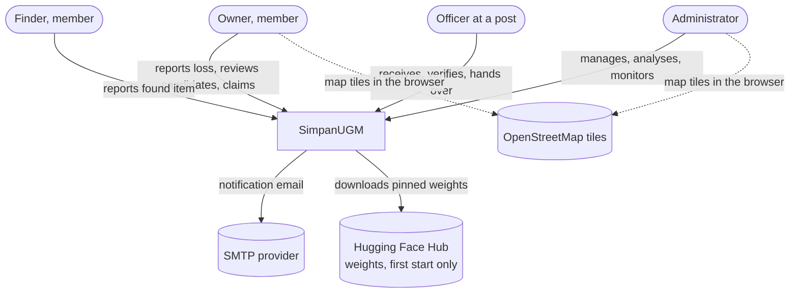
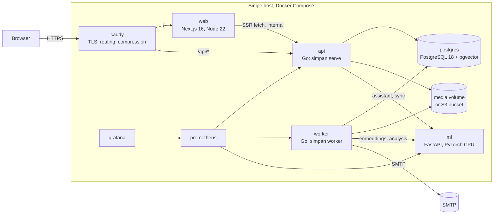
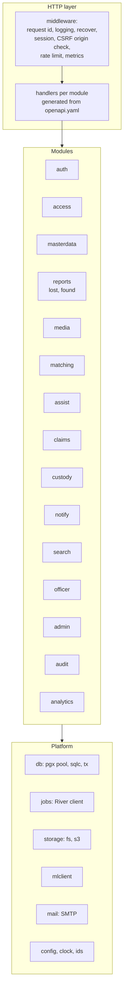
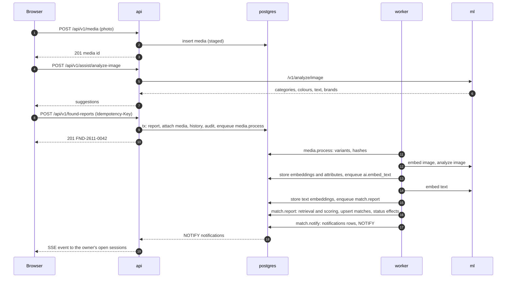
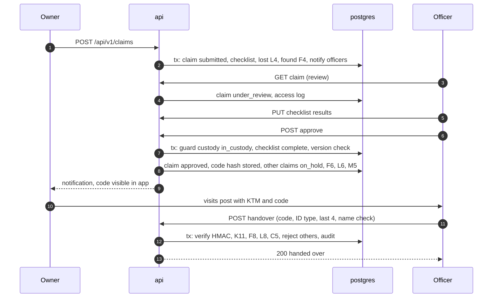
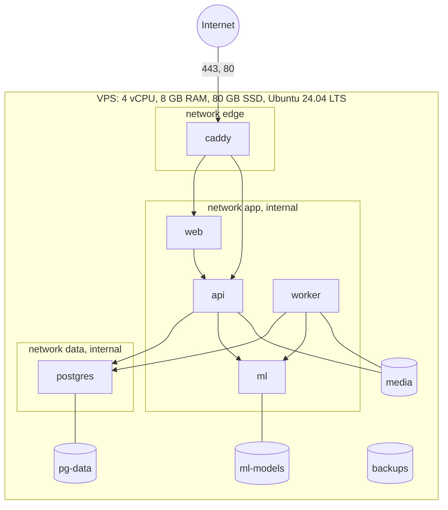

# Architecture Overview | SimpanUGM

| | |
|---|---|
| Owner | Pison Golda |
| Style | Modular monolith in Go, a Next.js frontend, a stateless Python inference service, one PostgreSQL |
| Decisions | [adr/](adr/) |

## 1. Quality goals that shaped it

| Priority | Goal | Consequence |
|---|---|---|
| 1 | Correct and accountable handovers | All state in one transactional database. State machines enforced in one service with optimistic locking |
| 2 | Privacy of people and items | Authorisation and field projection centralised in `api`. Media never public. Inference on our own server |
| 3 | Buildable by three people in nine weeks | One deployable backend, one database for relational data, vectors and jobs. No message broker, no separate vector store |
| 4 | Operable on one small server | CPU models, Docker Compose, a single reverse proxy with automatic TLS |
| 5 | AI results that can be explained and reproduced | Scores computed in Go from stored components under a versioned configuration |

## 2. System context

No other system holds or receives SimpanUGM data. Map tiles are fetched by the browser
and carry no report data.

## 3. Containers

| Container | Responsibility | Scales by |
|---|---|---|
| `caddy` | TLS termination with automatic certificates, HTTP/2 and HTTP/3, routing `/api/*` to `api` and the rest to `web`, gzip and zstd, security headers, request id generation | single instance |
| `web` | Every page, server side rendering, the route guards, the typed API client. No database access, no secrets beyond the internal API URL | stateless, more replicas |
| `api` | HTTP API, authentication, authorisation, domain logic, state machines, field projection, SSE, enqueueing jobs | stateless, more replicas |
| `worker` | River job processing: media variants, inference calls, matching, notifications, email, periodic jobs | more replicas, River coordinates |
| `ml` | Embeddings, image analysis, clustering. No database, no storage, no state beyond loaded weights | one per host, CPU bound |
| `postgres` | Relational data, pgvector indexes, River job tables, `LISTEN` and `NOTIFY`, materialised views for analytics | vertical |
| media | Photo variants and evidence behind the storage interface | volume or bucket |
| `prometheus`, `grafana` | Metrics and dashboards | single instance |

`api` and `worker` are one Go binary with two commands, so domain code is shared and
always deployed in lockstep. Other commands: `simpan migrate`, `simpan seed`,
`simpan admin create`.

## 4. Components inside `api`

Each module owns its tables and exposes a service interface. Modules call each other's
services, never each other's queries. A module may read another module's tables only
through a read model the owner publishes (for example `search` reads a view that
`reports` defines).

| Module | Owns | Notes |
|---|---|---|
| `auth` | users, sessions, auth tokens | argon2id, session cookies, invitations |
| `access` | role to permission map, scope checks | pure functions, no tables |
| `masterdata` | categories, compatibility, zones, locations, posts, officer assignments, synonyms, brands | seed command |
| `reports` | lost and found reports, places, status history, code sequences | state machines L and F |
| `media` | media objects, variants, hashes, staging | storage interface |
| `matching` | embeddings, attributes, matches, feedback, model versions, fusion configs | retrieval and scoring, state machine M |
| `assist` | none | orchestrates the sync analysis call and masking |
| `claims` | claims, answers, evidence, messages, checklist | state machine K |
| `custody` | custody events, dispositions, handover codes | state machine C |
| `notify` | notifications, preferences, email jobs, SSE hub | `LISTEN notifications` |
| `search` | none, reads published views | trigram, full text, vector |
| `officer` | none | priority queue and review board read models |
| `admin` | system settings, moderation records | settings cache |
| `audit` | audit log, access log | append only |
| `analytics` | materialised views | refresh job |

## 5. Key runtime flows

### 5.1 Found report to candidates to notification

### 5.2 Claim, approval, handover

### 5.3 Live notifications

The SSE endpoint holds one connection per open tab. Each `api` instance keeps a map of
user id to connections and one `LISTEN notifications` connection to PostgreSQL. A worker
or another instance that creates a notification issues `NOTIFY notifications, '<user id>'`
after commit. The receiving instance reads the new rows for that user and writes them to
the stream. On reconnect the browser sends `Last-Event-ID`, the notification id, and
receives everything newer. A heartbeat comment every 25 s keeps proxies from closing the
stream.

## 6. Cross cutting concerns

| Concern | Decision |
|---|---|
| Transactions | A request handler runs one transaction for one use case. Audit, history, notifications and job enqueueing (River's `InsertTx`) happen inside it, so either everything or nothing is committed |
| Concurrency | `version` column on mutable aggregates. A stale write returns `409 conflict` with code `stale_version` |
| Idempotency | `Idempotency-Key` on create endpoints stored with the response for 24 hours |
| Time | `timestamptz` in UTC everywhere. Conversion to `Asia/Jakarta` only in the presentation layer and in job schedules, which name the zone explicitly. Codes use the WIB month (BR-ID-01) |
| Identifiers | UUIDv7 generated in Go |
| Errors | RFC 9457 problem details with stable codes, see [api.md](api.md) |
| Configuration | environment variables parsed once at start into a typed struct, refusing to start on a missing required value |
| Logging | `log/slog` JSON in Go, structured JSON from Next.js and FastAPI, common fields in [observability.md](../operations/observability.md) |
| Request id | `X-Request-Id` set by Caddy when absent, forwarded by `web`, logged by `api`, passed to `ml` and stored in job metadata |
| Feature flags | environment flags read at start, for features that land across several pull requests |

## 7. Deployment view

Only `caddy` publishes ports. `ml` and `postgres` are on internal networks without
published ports. Memory budget: postgres 2 GB, ml 3 GB, api and worker 512 MB each, web
512 MB, caddy, prometheus and grafana 512 MB together, leaving headroom for the OS. Full
procedure in [deployment.md](../operations/deployment.md).

## 8. Where to go next

| Topic | Page |
|---|---|
| Tables and constraints | [data-model.md](data-model.md) |
| Endpoints | [api.md](api.md) |
| Security and privacy | [security-privacy.md](security-privacy.md) |
| Matching internals | [../ai/matching-engine.md](../ai/matching-engine.md) |
| Folder layout per service | [../engineering/repository-structure.md](../engineering/repository-structure.md) |
