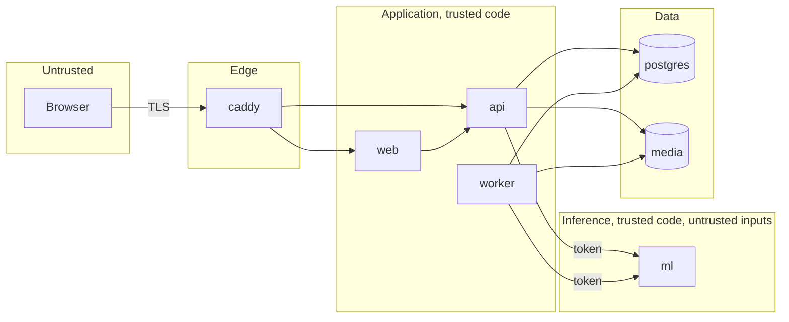

# Security and Privacy | SimpanUGM

| | |
|---|---|
| Owner | Pison Golda |
| Reviewers | Irfan Fadilah Rafif, Axelle Chandra |
| Standard | OWASP ASVS 4.0.3 level 2 for V2 authentication, V3 sessions, V4 access control. OWASP Top 10 2021 as the review checklist |
| Law | UU No. 27 Tahun 2022 tentang Pelindungan Data Pribadi |

A lost and found system concentrates exactly the data a thief or an impersonator wants:
what valuable item is where, who owns it, and what details prove ownership. Security here
is mostly about **who can see what** and **who can take what home**.

## 1. Assets

| Asset | Why it matters |
|---|---|
| Items in custody | physical value, the handover is the irreversible step |
| Hidden details of found items, private details of lost items, claim answers | the secrets that prove ownership. If leaked, anyone can pass verification |
| Found item photos | reveal what is waiting to be claimed and help a false claimant describe it |
| Personal data | names, emails, phones, NIM or NIP, places and times of a person's movements |
| Officer accounts | can approve claims and hand over items |
| Audit trail | the only defence of an officer in a dispute |
| Model and fusion configuration | a silently changed threshold changes who is told about an item |

## 2. Trust boundaries

| Boundary | Crossing | Controls |
|---|---|---|
| Internet to edge | every request | TLS 1.2 or newer, HSTS, HTTP/3, request size limits, request id |
| Edge to `api` | `/api/*` | session cookie, origin check, rate limits, input validation, authorisation |
| Edge to `web` | pages | `web` holds no secrets and no data access, so a compromise of `web` gains only what a browser has |
| `api` and `worker` to `ml` | images and text from users | internal network only, bearer token, size limits enforced again in `ml`, images re-encoded by `api` before they reach `ml` |
| Application to data | queries, objects | least privilege database roles, parameterised queries only, object keys never derived from user input |

## 3. Threat model

STRIDE over the flows of architecture overview section 5.

| # | Threat | Flow | Mitigation | Requirement |
|---|---|---|---|---|
| T1 | Spoofing: guessing or stuffing passwords | sign in | argon2id, common password list, per IP and per account limits, delay after failures, uniform error message | NFR-SEC-03, BR-SEC-01, BR-SEC-02 |
| T2 | Spoofing: stolen session cookie | every request | `HttpOnly`, `Secure`, `SameSite=Lax`, short officer sessions with idle timeout, session list with revoke, token stored hashed | FR-AUTH-05, BR-ACC-04 |
| T3 | Spoofing: a false owner claims an item | claim, handover | owner sees only matched candidates, hidden details never shown, category questions, checklist, in person ID with name match, one time code, claim limits and restriction | BR-VIS, BR-CLM, BR-HND |
| T4 | Tampering: cross site request forgery on approve or handover | unsafe methods | `SameSite=Lax`, origin or `Sec-Fetch-Site` check, no state change on `GET` | NFR-SEC-04 |
| T5 | Tampering: two officers act on one claim at once | approve, handover | `version` column, `If-Match`, partial unique index on approved claims | data-model 4.6 |
| T6 | Tampering: SQL injection | all queries | sqlc generated queries with parameters only, no string concatenated SQL, linter rule | coding-standards |
| T7 | Tampering: malicious image, decompression bomb, polyglot file | upload | signature check, `image.DecodeConfig` before decode with a 40 megapixel cap, full re-encode, metadata dropped, served with the stored type and `nosniff` | FR-MEDIA-01, FR-MEDIA-04 |
| T8 | Repudiation: an officer denies a handover | handover | audit entry in the same transaction, code verified, ID type and last four digits, name confirmation, append only audit table | FR-AUDIT-01, FR-AUDIT-02 |
| T9 | Information disclosure: enumeration of reports or accounts | read endpoints | out of scope reads return 404, registration and reset never reveal existence, codes alone grant nothing | permissions section 4 |
| T10 | Information disclosure: fishing for found item photos with vague lost reports | candidates | only tier medium and high, ten per report, five open lost reports per member, photo views logged and rate limited, AI-12 watch on members with many views and no claims | BR-LST-07, matching-engine section 12 |
| T11 | Information disclosure: location history from EXIF GPS | upload | metadata dropped on re-encode, verified by a test that uploads a GPS tagged fixture | NFR-PRIV-03 |
| T12 | Information disclosure: identity numbers on photographed cards | upload, OCR | blurred thumbnails for identity categories to non officers, masking of 16 digit and card numbers in text | BR-PRV-03 |
| T13 | Information disclosure: secrets in logs | logging | redaction middleware for `password`, `token`, `code`, `hidden_details`, `private_details`, `answers`, tests on log output | NFR-PRIV-06 |
| T14 | Information disclosure: insider officer browses private details | officer pages | access logged per record, admin review of access volume, private details collapsed by default and opened on purpose | FR-AUDIT-03 |
| T15 | Denial of service: upload or assistant floods | upload, assist | per user limits, body limits at Caddy and in `api`, River queue concurrency caps the CPU load of `ml` | BR-SEC-01 |
| T16 | Elevation of privilege: member calls officer endpoints | all | permission middleware plus service scope checks plus query scopes, table driven tests for every cell | permissions section 5 |
| T17 | Elevation of privilege: XSS through report text | pages | React escaping, no `dangerouslySetInnerHTML`, CSP without `unsafe-inline` scripts using nonces, text rendered as text | NFR-SEC-06 |
| T18 | Supply chain: compromised dependency or model weights | build, start | lock files, Dependabot, `govulncheck`, `pnpm audit`, `pip-audit`, weights pinned by revision hash and checked on download | NFR-SEC-09, NFR-REPRO-02 |
| T19 | Tampering: someone changes thresholds to hide matches | admin | thresholds only in versioned fusion configs, activation audited, admin accounts by invitation only | model-lifecycle |

## 4. Controls in detail

| Area | Control |
|---|---|
| Passwords | argon2id `m=19456 KiB, t=2, p=1`, 16 byte salt, PHC string. Rehash on login when parameters change. 10 to 128 characters, no composition rules, common list rejected |
| Session token | 32 random bytes, base64url, cookie `simpan_session`, `Path=/`, `HttpOnly`, `Secure`, `SameSite=Lax`. Rotated on sign in and on role change |
| Tokens in links | 32 random bytes, stored as SHA-256, single use, expiries per FR-AUTH |
| Handover code | 6 digits from `crypto/rand`, stored as HMAC-SHA256 with `HANDOVER_PEPPER`, compared in constant time, 5 attempts |
| Authorisation | section 4 of permissions, enforced in three layers |
| Input validation | OpenAPI schema validation of every request, then domain validation. Unknown fields rejected |
| Output | role specific response types, so forbidden fields cannot be serialised |
| Headers | set by Caddy: `Strict-Transport-Security: max-age=31536000; includeSubDomains`, `X-Content-Type-Options: nosniff`, `Referrer-Policy: strict-origin-when-cross-origin`, `Permissions-Policy: camera=(self), geolocation=(), microphone=()`, CSP from `web` with nonces and `frame-ancestors 'none'` |
| Media | never public, authorised endpoint, `Content-Disposition: inline`, stored type only, object keys are UUID paths |
| Database | roles of data-model section 3, TLS not required inside the host network, no superuser at runtime |
| Secrets | environment variables from a root owned `.env` file on the server with mode 600, never in the repository. Rotation in runbook section 6 |
| Backups | encrypted with restic, repository password kept offline by two members |
| Dependencies | Dependabot weekly for Go modules, pnpm and uv, CI scans block merges on high or critical |
| Disclosure | vulnerabilities are reported privately through GitHub's "Report a vulnerability" on the repository, see `SECURITY.md` |

## 5. Personal data inventory

| Data | Subject | Purpose | Who sees it | Retention |
|---|---|---|---|---|
| Name, email | every user | account, contact, ID match at handover | the user, officers, admins | until account deletion |
| Phone, NIM or NIP | users who give them | contact by officers | the user, officers, admins | until deletion |
| Proxy visitor name and phone | walk in visitors | contact for the case | officers, admins | BR-RET-01 |
| Places and times of loss | owners | matching | the owner, officers, admins | BR-RET-01 |
| Item descriptions, private details | owners, finders | matching, verification | per BR-VIS | BR-RET-01 |
| Photos | owners, finders | matching, verification | per BR-VIS | BR-RET-02 |
| Claim statements, answers, evidence, messages | claimants | verification | the claimant, officers, admins | BR-RET-03 |
| ID type and last four characters at handover | claimants | accountability | officers, admins | with the claim |
| IP, user agent | every user | security, audit | admins | sessions BR-RET-06, audit BR-RET-04 |

### 5.1 Principles of UU PDP applied

| Principle | How |
|---|---|
| Lawful basis and consent | Consent to the privacy notice at registration, versioned and recorded (FR-AUTH-14). Proxy reports are filed with the visitor's verbal consent, noted by the officer |
| Purpose limitation | Data is used for returning items and for aggregated campus safety statistics only. No marketing, no sharing |
| Minimisation | Phone and NIM or NIP optional. Only the last four characters of an ID are stored. EXIF removed |
| Accuracy | Users edit their profile and their reports |
| Storage limitation | BR-RET jobs |
| Security | this page |
| Rights of the data subject | access through the app, correction through editing, deletion through FR-AUTH-13. A data export (`GET /me/export`) is planned for v1.1 |
| Breach notification | within 3 times 24 hours of discovery, to affected users by email and to the university, as in runbook section 7 |

## 6. Retention rationale

| Period | Reason |
|---|---|
| Photos 90 days after closure | long enough to settle a dispute about a handover, short enough not to build an archive of people's belongings |
| Personal fields 12 months after closure | covers a full academic year of possible follow up |
| Audit 24 months | covers two academic years for accountability |
| Anonymised statistics indefinitely | contain no personal data after BR-RET-01 |

## 7. Privacy by design in the AI

| Concern | Decision |
|---|---|
| Inference location | all models run on our server. No report text or photo is sent to a third party API (CON-05) |
| Use of private fields | private and hidden details improve matching internally, but explanations never quote them (BR-VIS-04) |
| Identity documents | OCR text of identity items is visible to officers only and numbers are masked before storage |
| Evaluation data | collected with consent from team members and friends, mock identity cards only, see dataset-collection |
| Analytics | aggregates with suppression under 3 |

## 8. Release checklist

To be completed and committed as a filled copy in `docs/operations/release-checklist-v1.0.0.md`
before tagging v1.0.0.

- [ ] Permission matrix tests pass for every cell.
- [ ] Response snapshot tests prove members never receive restricted fields.
- [ ] EXIF fixture test passes. Masking fixture test passes.
- [ ] Rate limits verified with an automated test per limit.
- [ ] CSP and security headers verified on staging with an automated header test.
- [ ] ZAP baseline scan of staging with no high finding.
- [ ] `govulncheck`, `pnpm audit --prod`, `pip-audit` clean of high and critical.
- [ ] Secrets present only in the server `.env`, repository scanned with gitleaks.
- [ ] Database roles verified: `simpan_app` cannot update or delete `audit_logs`.
- [ ] Backup restore drill done and timed.
- [ ] Privacy notice and terms published and linked.
- [ ] Two members other than the author reviewed this page against the implementation.
