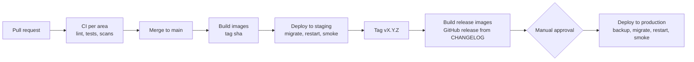

# Deployment | SimpanUGM

| | |
|---|---|
| Owner | Pison Golda |
| Target | One VPS per environment, Docker Compose, images from GitHub Container Registry |

## 1. Environments

| Environment | URL | Deployed from | Data | Purpose |
|---|---|---|---|---|
| local | <http://localhost:8000> | working tree | seeds and demo data | development |
| e2e | ephemeral in CI | pull request | demo seed, fake clock | end to end tests |
| staging | `https://staging.simpanugm.my.id` | every merge to `main` | demo seed, reset weekly | integration, usability tests, load tests |
| production | `https://simpanugm.pisondev.com` | tags `v*`, manual approval | real data | pilot and final demonstration |

Staging and production run on separate VPS instances of the same size, so a load test on
staging says something about production. The production hostname was selected by the
owner and is not live yet. Follow the [Hestia live deployment guide](hestia-live-deployment.md)
for the current DNS, VPS capacity, root access and SMTP prerequisites. Its DNS record is
created only after the VPS can serve the app.

## 2. Server

| Item | Specification |
|---|---|
| Size | 4 vCPU, 8 GB RAM, 80 GB SSD, a region in Indonesia or Singapore for latency |
| OS | Ubuntu 24.04 LTS, unattended security upgrades on |
| Access | SSH keys only, password login off, a `deploy` user in the `docker` group, root login off |
| Firewall | `ufw` allowing 22 from the team's addresses, 80 and 443 from anywhere |
| Layout | `/opt/simpanugm/` holding `compose.yaml`, `compose.prod.yaml`, `Caddyfile`, `env/` with mode 600, `backups/` |
| Docker | Engine 27 or newer, log driver `json-file` with `max-size=20m`, `max-file=5` |

## 3. Images

| Image | Built from | Base |
|---|---|---|
| `ghcr.io/pisondev/simpanugm-api` | `api/Dockerfile`, multi stage | `gcr.io/distroless/static-debian12`, non root |
| `ghcr.io/pisondev/simpanugm-web` | `web/Dockerfile`, Next.js standalone output | `node:22-alpine`, non root |
| `ghcr.io/pisondev/simpanugm-ml` | `ml/Dockerfile`, uv, CPU torch | `python:3.12-slim`, non root, no weights inside |

Every image is tagged with the version and the commit SHA, labelled with OCI metadata, and
referenced by digest in `compose.prod.yaml`.

## 4. Pipeline



| Workflow | Trigger | Does |
|---|---|---|
| `release.yml` | push to `main`, tags `v*` | builds three images with Buildx and layer cache, pushes to GHCR, on tags creates the GitHub release with the changelog section |
| `deploy.yml` | after `release.yml` on `main` for staging, manual `workflow_dispatch` with an environment and a version for production | SSH to the server with an environment scoped key, runs the deploy script |

GitHub environment `production` requires approval from a member other than the one who
triggered the run.

## 5. Deploy script

`deploy/scripts/deploy.sh <version>`, run on the server by the workflow:

1. Write the image digests for `<version>` into `compose.prod.yaml` overrides.
2. `docker compose pull`.
3. Production only: run the backup of runbook section 3 and verify the dump is readable.
4. `docker compose run --rm api simpan migrate`. Migrations are written to be compatible
   with the previous release (coding-standards section 5), so old containers keep working
   during the switch.
5. `docker compose up -d --remove-orphans`. `web`, `api` and `worker` restart one after
   another with health checks, `ml` restarts only when its digest changed.
6. Smoke test: `/healthz` and `/readyz` of every service, sign in with the smoke account,
   `GET /api/v1/me`, open the landing page. Failure triggers step 7.
7. Rollback: re-apply the previous digests and `up -d`. A failed migration is rolled back
   with `simpan migrate down` only if its down step is marked safe, otherwise restore from
   the step 3 backup following the runbook.

Expected impact: at most 10 seconds of failed requests during the restart (US-53).

## 6. Caddy

```
{$PUBLIC_HOST} {
    encode zstd gzip
    request_header +X-Request-Id {http.request.uuid}
    header {
        Strict-Transport-Security "max-age=31536000; includeSubDomains"
        X-Content-Type-Options nosniff
        Referrer-Policy strict-origin-when-cross-origin
        Permissions-Policy "camera=(self), geolocation=(), microphone=()"
        -Server
    }
    request_body /api/v1/media* {
        max_size 11MB
    }
    request_body {
        max_size 1MB
    }
    handle /api/* {
        reverse_proxy api:8090 {
            flush_interval -1
        }
    }
    handle {
        reverse_proxy web:3000
    }
    log {
        output stdout
        format json
    }
}
```

`flush_interval -1` keeps Server Sent Events streaming. The request id header is set only
when absent, by a matcher in the real file. The Content Security Policy is set by `web`
because it carries a per request nonce.

## 7. Secrets

| Secret | Where | Rotation |
|---|---|---|
| Database passwords for `simpan_owner`, `simpan_app`, `simpan_readonly` | server `env/` | runbook section 6 |
| `ML_INTERNAL_TOKEN` | server `env/` | on suspicion, restart `api`, `worker`, `ml` together |
| `HANDOVER_PEPPER` | server `env/` | rotating invalidates outstanding codes, so officers regenerate them. Only on suspicion |
| SMTP credentials | server `env/` | per provider policy |
| Deploy SSH key | GitHub environment secret | each semester |
| restic password | offline, held by two members | never stored on the server in plain text, read from a root only file |

## 8. Release process

1. Every story of the milestone is merged and staging has been green for a day.
2. A release pull request moves `Unreleased` in `CHANGELOG.md` under the new version and
   updates any doc that the milestone changed.
3. For v1.0.0, the security release checklist and a restore drill are complete.
4. Tag `vX.Y.Z` on `main`, approve the production deployment, watch Grafana for 30 minutes.
5. Announce in the team chat with the changelog link.
