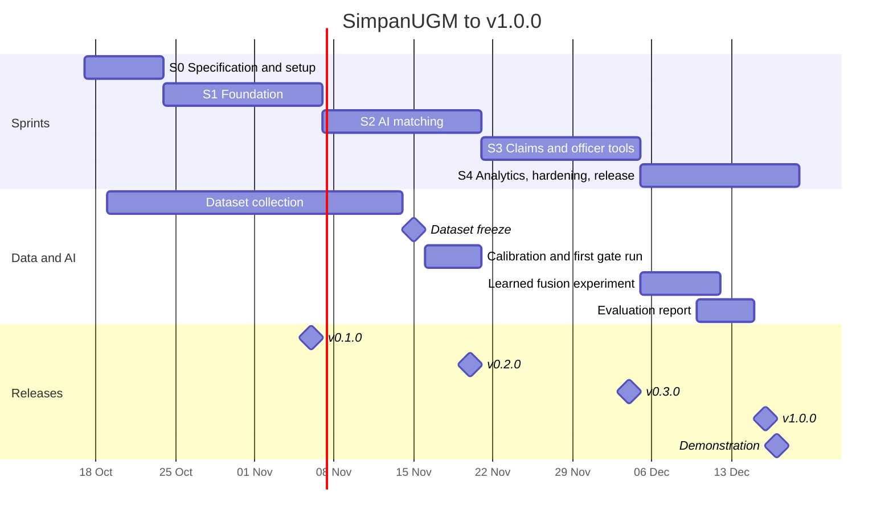
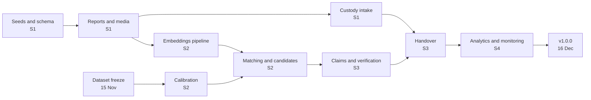

# Project Plan | SimpanUGM

| | |
|---|---|
| Owner | Pison Golda |
| Start | Saturday 17 October 2026 |
| Release | v1.0.0, Wednesday 16 December 2026 |
| Final demonstration | Thursday 17 December 2026, in class, 07:15 WIB |
| Cadence | Two week sprints from Saturday to Friday, ending the day after the Thursday class |

## 1. Timeline

## 2. Sprints

Story points per sprint come from [user-stories.md](../product/user-stories.md).

### Sprint 0, 17 to 23 October: specification and setup

| Member | Work |
|---|---|
| Pison | This specification, repository and branch protection, GitHub project board with one issue per story, labels, VPS and domain choice |
| Irfan | Review of matching-engine and evaluation, CPU latency spike of the four models on a laptop to confirm the budget of matching-engine section 10 |
| Axelle | Consent form, dataset protocol trial with 20 items, mock identity cards, location list from OpenStreetMap for review |

Exit: specification merged on `main`, every story is an issue on the board, dataset trial
done.

### Sprint 1, 24 October to 6 November: foundation, 73 points

| Area | Stories and tasks |
|---|---|
| Platform | US-50 compose stack, skeletons of `api`, `web`, `ml`, Makefile. US-51 CI. `openapi.yaml` first version. Staging VPS with Caddy |
| Accounts | US-01, US-02, US-03, US-04 |
| Master data | US-06 seeds and picker |
| Reports | US-08, US-09, US-10, US-12, US-13, US-17 |
| Custody and search | US-30, US-32, US-37 |
| ML | service skeleton with `/v1/embed/image`, `/v1/embed/text`, `/v1/models`, `models.lock.json` pinned |
| Data | 150 items photographed and described, labels, `data/seed/` complete |

Exit, release v0.1.0: J1 passes, a member files both report types with photos on staging,
an officer receives an item into custody and finds any report by code or text.

### Sprint 2, 7 to 20 November: AI matching, 71 points

| Area | Stories and tasks |
|---|---|
| Matching | US-18, US-19, US-20, US-21, US-22 |
| Assistant | US-23, US-24 |
| Finder | US-14 |
| Notifications | US-35, US-36 |
| Accounts and admin | US-05, US-07 |
| ML | `/v1/analyze/image`, golden tests, fusion reference in `ml/eval/fusion.py`, shared fixtures |
| Data and evaluation | 400 distractors, 40 duplicates, 50 queries, freeze on 15 November, calibration on `val`, first gate run on `test` |

Exit, release v0.2.0: J2 and J3 pass, candidates appear within 60 s on staging, first
evaluation run recorded with its gate table.

### Sprint 3, 21 November to 4 December: claims and officer tools, 70 points

| Area | Stories and tasks |
|---|---|
| Claims | US-25, US-26, US-27, US-28, US-29 |
| Custody | US-31, US-33, US-34 |
| Lost and found lifecycle | US-11, US-15, US-16 |
| Officer workspace | US-38, US-39, US-40 |
| Quality | first load test, usability test round 1 with 5 participants |

Exit, release v0.3.0: J4, J5 and J6 pass, a full loss to handover cycle works on staging
with two officers and two members.

### Sprint 4, 5 to 18 December: analytics, hardening, release, 68 points

| Area | Stories and tasks |
|---|---|
| Administration | US-42, US-43, US-44, US-45 |
| Analytics and AI | US-46, US-47, US-48, US-49, US-41 |
| Operations | US-52, US-53, US-54, US-55, production server, restore drill |
| AI | learned fusion experiment, final gate run, evaluation report with model cards |
| Quality | usability test round 2 bringing the total to at least 10 participants, second load test, security checklist |
| Release | v1.0.0 on Wednesday 16 December, demonstration on Thursday 17 December, Friday 18 December as buffer |

Exit, release v1.0.0: every checkbox of prd section 9 ticked, J7 passes, evaluation report
merged.

## 3. Milestone exit criteria

A milestone is released only when all of these hold.

| Criterion | v0.1 | v0.2 | v0.3 | v1.0 |
|---|---|---|---|---|
| Stories of the sprint done per definition-of-done | yes | yes | yes | yes |
| End to end journeys passing | J1 | J1 to J3 | J1 to J6 | J1 to J7 |
| Staging deployed from the tag | yes | yes | yes | yes |
| Evaluation gate run recorded | | yes | | yes, final |
| Load test passing | | | yes | yes |
| Usability test | | | round 1 | round 2, targets of prd section 8 |
| Security checklist | | | | complete |
| Restore drill | | | | done and timed |
| Production deployment | | | | yes |

## 4. Work breakdown

| # | Package | Owner | Sprints |
|---|---|---|---|
| 1 | Specification | Pison | 0, kept current after |
| 2 | Platform: repository, CI, Compose, staging, production, observability, backups | Pison | 1, 4 |
| 3 | `api` modules: auth, access, masterdata, reports, media, custody, search | Pison | 1 |
| 4 | `api` modules: matching integration, assist, notify | Pison with Irfan | 2 |
| 5 | `api` modules: claims, officer, retention jobs | Pison | 3 |
| 6 | `api` modules: admin, audit viewer, analytics | Pison with Axelle | 4 |
| 7 | `web`: member flows | Pison | 1 to 3 |
| 8 | `web`: officer workspace | Pison | 1, 3 |
| 9 | `web`: admin, analytics, AI pages | Axelle with Pison | 4 |
| 10 | `ml` service: encoders, analysis, clustering | Irfan | 1 to 2, 4 |
| 11 | Scoring and fusion in Go, fixtures shared with Python | Irfan with Pison | 2 |
| 12 | Evaluation dataset, seeds, synonyms, brands | Axelle | 0 to 2 |
| 13 | Evaluation harness, calibration, gate runs, report | Irfan | 2, 4 |
| 14 | Analytics views and queries | Axelle | 4 |
| 15 | Quality: end to end, load, security, usability tests | all, led by Pison | 3, 4 |
| 16 | Release and demonstration | all | 4 |

Packages 9 and 14 put Axelle on frontend and SQL work in Sprint 4 so the load on Pison in
`web` stays bounded. Irfan pairs on package 11 because the Go scoring must match the
Python reference exactly.

## 5. Critical path

The dataset freeze and the embeddings pipeline are the two dates that move everything
after them. If either slips by more than three days, Sprint 4's Should stories (US-41,
US-48, learned fusion) are dropped first, in that order.

## 6. Scope control

| Lever | Order of use |
|---|---|
| Drop Should stories | US-41 semantic search, then US-48 clustering, then learned fusion, then US-40 merge duplicates, then US-15 duplicate hints, then US-34 transfers |
| Simplify | officer digest emails become in app only, hotspot insights lines are dropped while the map stays |
| Never cut | anything in prd section 9, the claim and handover flow, the evaluation gate run, the explainable match view |

## 7. Demonstration plan, 17 December

| Minute | Segment | Who |
|---|---|---|
| 0 to 2 | The problem and the product in one slide | Pison |
| 2 to 6 | Live: a finder reports earbuds with a photo, the assistant fills the form, the hint appears | Axelle |
| 6 to 10 | Live: an owner without a photo reports the loss, candidates with explanation, claim | Pison |
| 10 to 13 | Live: officer queue, review board, verification checklist, approve, handover with code | Pison |
| 13 to 16 | The AI engineering: pipeline, evaluation gates and results, ablations, monitoring and rollback | Irfan |
| 16 to 18 | Production readiness: deployment, observability dashboard, backups and restore drill, security | Pison |
| 18 to 20 | Questions | all |

A recorded run of the same script is prepared on 15 December as a fallback if the
network fails in class.
