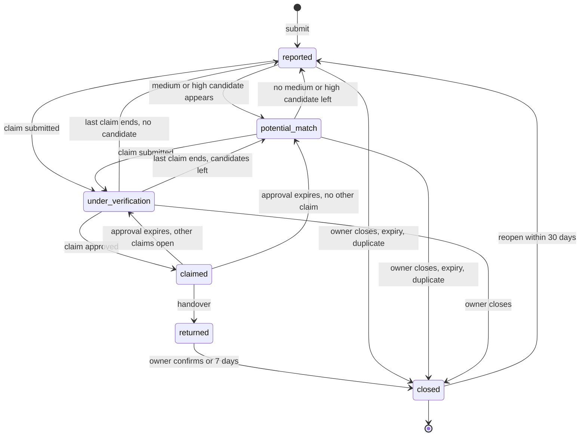
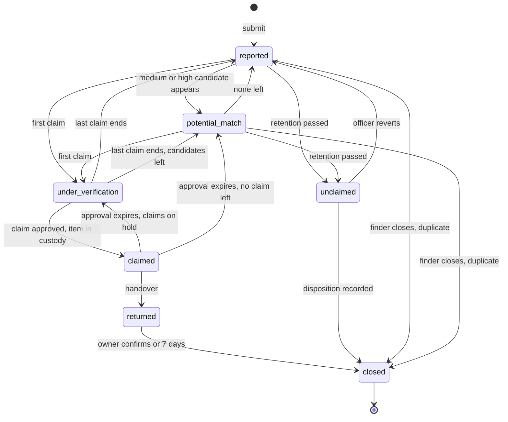
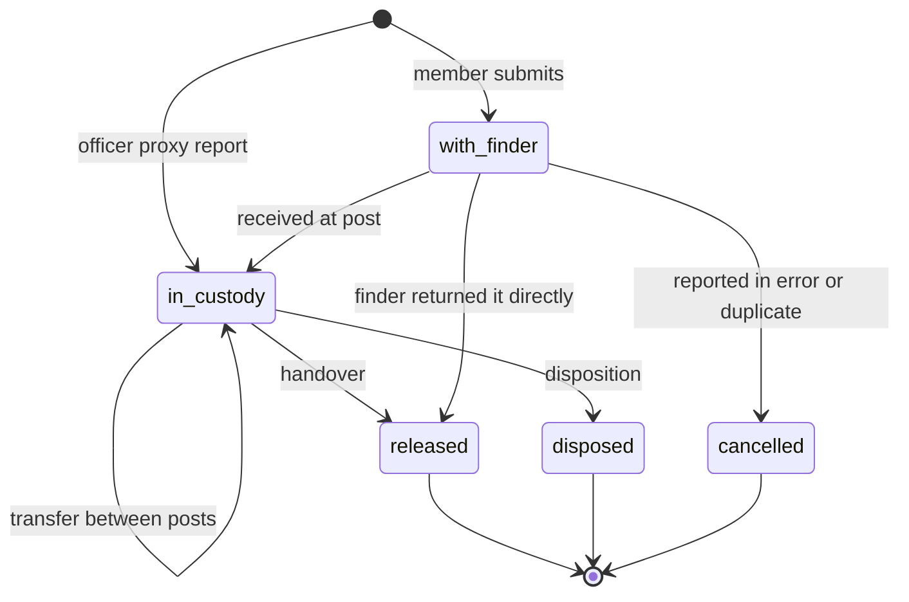
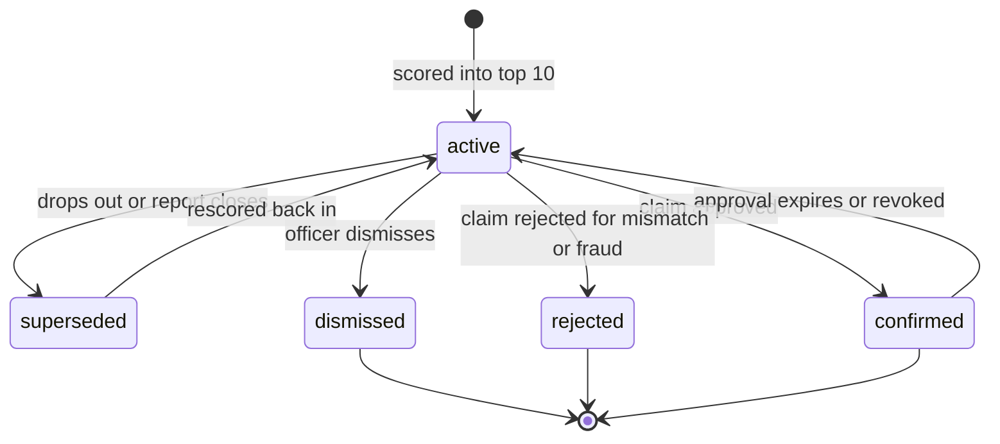
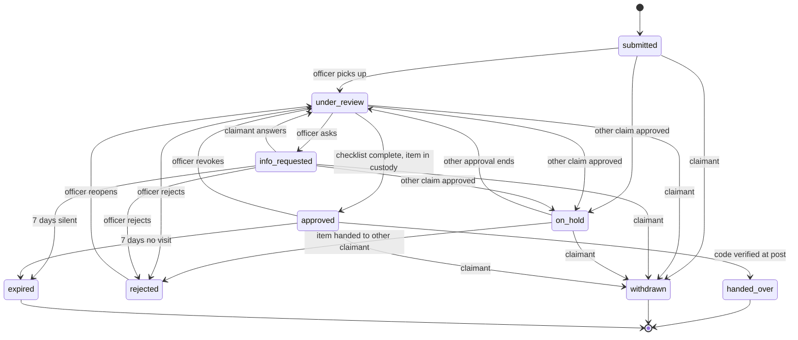

# State Machines | SimpanUGM

Five lifecycles drive the product. Each is implemented in `api/internal/<module>/` as one
transition function per entity that checks the guard, writes the new state, appends the
status history and the audit entry, and enqueues side effects, all in one transaction.
The row carries a `version` column for optimistic locking, so two officers acting at once
cannot both win.

Notation in the tables: **Actor** is who triggers the event. `system` is a background job
or a reaction inside `api`. **Effects** happen in the same transaction unless marked
*(job)*, which means a job is enqueued in that transaction and runs after commit.

## 1. Lost report

The concept document names the case statuses Reported, Potential Match, Under
Verification, Claimed, Returned and Closed. Those are the lost report states, with the
Indonesian label shown to users.

| State | Label in UI | Meaning |
|---|---|---|
| `reported` | Dilaporkan | Open, no candidate of tier medium or high |
| `potential_match` | Ada kandidat | Open, at least one active candidate of tier medium or high |
| `under_verification` | Dalam verifikasi | At least one open claim made from this report |
| `claimed` | Klaim disetujui | A claim was approved, waiting for handover |
| `returned` | Sudah kembali | Handover recorded, inside the 7 day confirmation window |
| `closed` | Ditutup | Terminal, with a close reason |

| # | From | Event | To | Actor | Guard | Effects |
|---|---|---|---|---|---|---|
| L1 | none | submit | `reported` | owner, officer for proxy | BR-LST-01, BR-LST-07, account verified | code assigned, *(job)* embed and match |
| L2 | `reported` | candidate tier medium or high becomes active | `potential_match` | system | none | *(job)* notify owner per BR-NTF-01 if tier high |
| L3 | `potential_match` | last medium or high candidate leaves `active` | `reported` | system | none | none |
| L4 | `reported`, `potential_match` | claim submitted from this report | `under_verification` | owner | claim guards of section 5 | claim created |
| L5 | `under_verification` | last open claim rejected, withdrawn or expired | `reported` or `potential_match` | system | none | target chosen by L2 rule |
| L6 | `under_verification` | claim approved | `claimed` | officer | claim K6 guards | none beyond the claim |
| L7 | `claimed` | approved claim expires, is withdrawn or revoked | `under_verification` if another claim of this report is open, else `potential_match` or `reported` | system, owner, officer | none | none |
| L8 | `claimed` | handover recorded | `returned` | officer | claim K11 | owner asked to confirm receipt |
| L9 | `returned` | owner confirms, or 7 days pass | `closed` reason `returned` | owner, system | none | candidates set to `superseded` except the confirmed one |
| L10 | `reported`, `potential_match`, `under_verification` | owner closes | `closed` reason `found_by_owner` or `no_longer_needed` | owner | none | open claims withdrawn, candidates `superseded` |
| L11 | `reported`, `potential_match` | BR-LST-03 expiry | `closed` reason `expired` | system | no open claim | candidates `superseded` |
| L12 | `closed` with reason `expired`, `found_by_owner`, `no_longer_needed` | reopen | `reported` | owner | within BR-LST-04 | *(job)* embed and match |
| L13 | any open | marked duplicate | `closed` reason `duplicate`, `duplicate_of` set | officer | survivor is open and same owner | photos and claims moved to survivor |
| L14 | any open | owner account deleted | `closed` reason `account_deleted` | system | BR-RET-05 | open claims withdrawn |

## 2. Found report

| State | Label in UI | Meaning |
|---|---|---|
| `reported` | Dilaporkan | Open, no candidate of tier medium or high |
| `potential_match` | Ada kandidat pemilik | Open, at least one active candidate of tier medium or high |
| `under_verification` | Dalam verifikasi | At least one open claim on this item |
| `claimed` | Klaim disetujui | One claim approved, waiting for handover |
| `returned` | Sudah kembali | Handed over to its owner |
| `unclaimed` | Tidak diklaim | Retention passed, waiting for a disposition |
| `closed` | Ditutup | Terminal, with a close reason |

| # | From | Event | To | Actor | Guard | Effects |
|---|---|---|---|---|---|---|
| F1 | none | submit | `reported` | finder, officer for proxy | BR-FND-01, BR-FND-02, BR-FND-04, at least one photo | code assigned, custody per section 3, *(job)* embed, analyse, match |
| F2 | `reported` | medium or high candidate becomes active | `potential_match` | system | none | *(job)* finder hint updated, officer queue updated |
| F3 | `potential_match` | none left | `reported` | system | none | none |
| F4 | `reported`, `potential_match` | first open claim | `under_verification` | owner | claim guards | BR-CLM-07 escalation if custody `with_finder` |
| F5 | `under_verification` | last open claim ends without approval | `reported` or `potential_match` | system | none | none |
| F6 | `under_verification` | claim approved | `claimed` | officer | custody `in_custody` | other open claims set `on_hold` |
| F7 | `claimed` | approved claim expires, withdrawn or revoked | `under_verification` if claims on hold, else `potential_match` or `reported` | system, owner, officer | none | claims on hold return to `under_review` |
| F8 | `claimed` | handover | `returned` | officer | BR-HND-02, BR-HND-03, BR-CUS-03 | custody `released`, other claims rejected, *(job)* notify finder |
| F9 | `returned` | owner confirms or 7 days | `closed` reason `returned` | system | none | none |
| F10 | `reported`, `potential_match` | BR-CUS-02 retention passed | `unclaimed` | system | custody `in_custody`, no open claim | *(job)* notify post officers |
| F11 | `unclaimed` | officer reverts | `reported` | officer | custody `in_custody` | due date set to now plus 7 days, *(job)* match |
| F12 | `unclaimed` | disposition recorded | `closed` reason `disposed` | officer | BR-CUS-03, BR-CUS-04 | custody `disposed`, disposition stored |
| F13 | `reported`, `potential_match` | finder closes | `closed` reason `returned_directly` or `reported_in_error` | finder | custody `with_finder`, no claim ever opened | custody `released` or `cancelled`, BR-FND-05 |
| F14 | `reported`, `potential_match` | marked duplicate | `closed` reason `duplicate` | officer | survivor open | photos moved to survivor, custody of the duplicate `cancelled` |

## 3. Custody

Custody is a separate field on the found report, because where the item physically is and
where the case stands are independent. An item can have a strong candidate while still in
the finder's bag.

| State | Label in UI | Meaning |
|---|---|---|
| `with_finder` | Masih dibawa penemu | Not yet at a post. `intended_post_id` says where it should go |
| `in_custody` | Disimpan di pos | At a post, with a storage slot and a retention due date |
| `released` | Sudah diserahkan | Left the system to its owner |
| `disposed` | Sudah ditindaklanjuti | Donated, destroyed, transferred to a unit, or returned to the finder |
| `cancelled` | Dibatalkan | The report was an error or a duplicate |

| # | From | Event | To | Actor | Guard | Effects |
|---|---|---|---|---|---|---|
| C1 | none | member submits | `with_finder` | finder | none | reminders scheduled per BR-FND-03 |
| C2 | none | officer proxy submits | `in_custody` | officer | officer assigned to the post | retention due computed |
| C3 | `with_finder` | received | `in_custody` | officer | BR-CUS-03 | retention due computed, reminders cancelled, *(job)* notify finder |
| C4 | `in_custody` | transfer | `in_custody` | officer | assigned to the source post | `custody_events` row, holding post changed |
| C5 | `in_custody` | handover | `released` | officer | found F8 | none beyond F8 |
| C6 | `in_custody` | disposition | `disposed` | officer | found F12 | none beyond F12 |
| C7 | `with_finder` | finder closes `returned_directly` | `released` | finder | found F13 | none |
| C8 | `with_finder` | `reported_in_error` or duplicate | `cancelled` | finder, officer | found F13 or F14 | none |

## 4. Match

A match row is one lost and found pair with its scores. Rescoring updates the same row,
so feedback and history stay attached.

| State | Meaning |
|---|---|
| `active` | Among the top 10 for at least one side and above the storage floor |
| `superseded` | Fell out of the top 10 or below the floor, or one report closed |
| `dismissed` | An officer judged it wrong. Hidden from everyone except in history |
| `confirmed` | A claim on this pair was approved. Positive label |
| `rejected` | A claim on this pair was rejected for a mismatch or fraud. Negative label |

An owner's dismissal does not change the state. It sets `owner_dismissed_at`, which hides
the row from that owner only (FR-AI-10).

| # | From | Event | To | Actor | Effects |
|---|---|---|---|---|---|
| M1 | none | scored above floor and in top 10 | `active` | system | lost and found L2 and F2 checks |
| M2 | `active` | rescored out, or a report closes or is hidden | `superseded` | system | L3 and F3 checks |
| M3 | `superseded` | rescored in | `active` | system | L2 and F2 checks |
| M4 | `active` | officer dismisses with reason | `dismissed` | officer | label stored in `match_feedback` |
| M5 | `active` | claim on the pair approved | `confirmed` | officer | none |
| M6 | `confirmed` | approval expires or is revoked | `active` | system, officer | none |
| M7 | `active` | claim on the pair rejected with `details_mismatch`, `insufficient_evidence` or `suspected_fraud` | `rejected` | officer | label stored |

Rescoring never touches rows in `dismissed`, `confirmed` or `rejected`.

## 5. Claim

| State | Label in UI | Meaning |
|---|---|---|
| `submitted` | Menunggu petugas | Waiting for an officer to pick it up |
| `under_review` | Sedang diperiksa | An officer is reviewing, recorded as `reviewer_id` |
| `info_requested` | Perlu info tambahan | Waiting for the claimant to answer |
| `on_hold` | Ditunda | Another claim on the same item was approved |
| `approved` | Disetujui | Handover code issued, waiting for the visit |
| `handed_over` | Sudah diserahkan | Terminal, success |
| `rejected` | Ditolak | Terminal unless reopened by an officer |
| `withdrawn` | Dibatalkan | Terminal, by the claimant or by a closed lost report |
| `expired` | Kedaluwarsa | Terminal, by BR-CLM-05 or BR-CLM-06 |

| # | From | Event | To | Actor | Guard | Effects |
|---|---|---|---|---|---|---|
| K1 | none | submit | `submitted` | owner, officer for a walk in visitor | BR-CLM-01 to BR-CLM-04, found report open and not `claimed` | code assigned, lost L4, found F4, checklist generated by AI-08, *(job)* notify post officers |
| K2 | `submitted` | officer opens it | `under_review` | officer | none | `reviewer_id` set |
| K3 | `under_review` | request info with message | `info_requested` | officer | message not empty | *(job)* notify claimant |
| K4 | `info_requested` | claimant answers | `under_review` | owner | message not empty | *(job)* notify reviewer |
| K5 | `info_requested` | 7 days without answer | `expired` | system | BR-CLM-05 | lost L5, found F5 |
| K6 | `under_review` | approve | `approved` | officer | custody `in_custody`, BR-CLM-09, BR-CLM-10 | handover code issued (BR-HND-01), other open claims K7, found F6, lost L6, match M5, *(job)* notify claimant |
| K7 | `submitted`, `under_review`, `info_requested` | another claim on the item approved | `on_hold` | system | none | *(job)* notify claimant |
| K8 | `on_hold` | the approved claim expires, is withdrawn or revoked | `under_review` | system | none | *(job)* notify claimant |
| K9 | `on_hold` | the item is handed to another claimant | `rejected` reason `item_already_returned` | system | none | *(job)* notify claimant |
| K10 | `under_review`, `info_requested` | reject with reason | `rejected` | officer | BR-CLM-08 | match M7 when the reason qualifies, BR-CLM-04 counter, *(job)* notify claimant |
| K11 | `approved` | handover | `handed_over` | officer | BR-HND-02, BR-HND-03, BR-CUS-03 | found F8, lost L8, custody C5 |
| K12 | `approved` | 7 days without handover | `expired` | system | BR-CLM-06 | code invalidated, found F7, lost L7, match M6, claims on hold K8 |
| K13 | `approved` | revoke with reason | `under_review` | officer | none | code invalidated, found F7, lost L7, match M6 |
| K14 | any open | withdraw | `withdrawn` | owner, system on L10 or L14 | none | found F5 or F7, lost L5 or L7 |
| K15 | `rejected` | reopen with reason | `under_review` | officer | none | BR-CLM-02 exception recorded |

## 6. Implementation notes

- Allowed states are `CHECK` constraints in the schema, so an invalid state cannot be
  written even by a buggy query.
- Each table in this page becomes one table driven unit test in Go: every row is a case
  that asserts the target state, and every pair not listed is a case that asserts the
  transition is refused.
- System events (L2, L3, L11, F10, K5, K12 and the reminders) are River jobs, either
  periodic or scheduled at a time computed when the state is entered, and each handler
  rechecks the guard before acting, because the world may have moved since scheduling.
