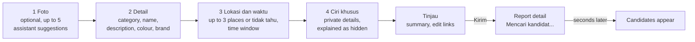
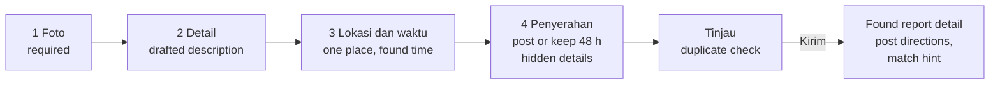
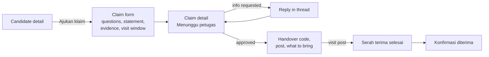
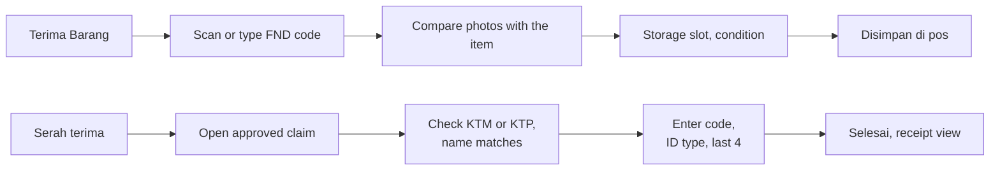

# Information Architecture | SimpanUGM

| | |
|---|---|
| Owner | Pison Golda |
| Language of the UI | Indonesian. Route segments are Indonesian too, so URLs read naturally when shared |

## 1. Navigation per role

| Role | Mobile | Desktop |
|---|---|---|
| Member | Bottom bar: Beranda, Laporan Saya, **Lapor** (centre button opening "Saya kehilangan" or "Saya menemukan"), Notifikasi, Profil | Top bar with the same items |
| Officer | Bottom bar: Beranda, Antrean, Terima, Cari, Lainnya | Left sidebar: Beranda, Antrean, Papan Tinjauan, Terima Barang, Inventaris, Klaim, Duplikat, Cari, Lapor atas Nama, Analitik |
| Admin | Same as officer, Lainnya holds the admin section | Officer sidebar plus a section Admin: Pengguna, Master Data, Moderasi, Audit, Analitik, AI, Pengaturan |

An officer or admin who also has personal reports reaches them from Profil, Laporan
Saya, so the member flows are never mixed into the work queue.

On a phone the member bar is Beranda, Laporan Saya, Lapor, Notifikasi with the unread
badge, and Profil. Barang Temuan sits in the desktop top bar and behind the Beranda
shortcut. On a desktop the bell in the header opens the latest notifications. Staff see
the bell in their header at every width, their phone bar holds Beranda, Terima, Cari,
Inventaris and Lainnya.

## 2. Route map

Next.js App Router with route groups. Codes appear in URLs (api section 1).

### 2.1 Public, no session

| Route | Screen |
|---|---|
| `/` | Landing: what SimpanUGM is, how it works in three steps, campus totals (returned this month), buttons Masuk and Daftar |
| `/masuk` | Sign in |
| `/daftar` | Register |
| `/verifikasi` | Verify email result, resend |
| `/lupa-sandi`, `/atur-sandi` | Forgot and reset password |
| `/undangan` | Accept an invitation, set password |
| `/privasi`, `/ketentuan`, `/bantuan` | Privacy notice, terms, help with the post list and opening hours |

### 2.2 Member, group `(member)`

| Route | Screen | Stories |
|---|---|---|
| `/beranda` | Home: active reports with status, newest candidates, claims needing action, shortcut buttons to report | US-09, US-35 |
| `/lapor/hilang` | Lost report form, four steps and review | US-08, US-23 |
| `/lapor/temuan` | Found report form, four steps and review | US-13, US-23, US-24, US-15 |
| `/laporan` | Laporan Saya with tabs Kehilangan, Temuan, Klaim | US-09 |
| `/laporan/hilang/[code]` | Lost report detail: status, timeline, candidates, claims, edit, close | US-09, US-10, US-11, AI-01 |
| `/laporan/hilang/[code]/kandidat/[matchId]` | Candidate detail with explanation and Ajukan klaim | US-20, US-21 |
| `/laporan/temuan/[code]` | Found report detail: custody instructions, match hint, timeline | US-14, US-16 |
| `/klaim/baru` | Claim form, `?found=` and `?lost=` or `?match=` | US-25 |
| `/klaim/[code]` | Claim detail: status, messages, handover code and instructions | US-27, US-28 |
| `/barang-temuan` | Public found listing with filters | US-17 |
| `/notifikasi` | Notification list | US-35 |
| `/profil`, `/profil/keamanan`, `/profil/notifikasi` | Profile, password and sessions, preferences, account deletion | US-05, US-45 |

### 2.3 Officer, group `(officer)`, prefix `/petugas`

| Route | Screen | Stories |
|---|---|---|
| `/petugas` | Officer home: counters and the priority queue | US-38 |
| `/petugas/antrean` | Full queue with filters by type and post | US-38 |
| `/petugas/tinjau` | Review board, `?lost=` or `?found=` | US-39 |
| `/petugas/terima` | Receive an item: scan or type a code, confirm, slot | US-30 |
| `/petugas/inventaris` | Post inventory, retention, transfers, dispositions | US-32, US-33, US-34 |
| `/petugas/klaim` | Claim queue | US-26 |
| `/petugas/klaim/[code]` | Claim review with the verification assistant | US-26, US-27 |
| `/petugas/serah-terima/[code]` | Handover screen | US-31 |
| `/petugas/duplikat` | Duplicate suggestions | US-40 |
| `/petugas/cari` | Search, keyword and semantic | US-37, US-41 |
| `/petugas/lapor-hilang`, `/petugas/lapor-temuan` | Proxy forms for walk ins | US-12 |
| `/petugas/laporan/hilang/[code]`, `/petugas/laporan/temuan/[code]` | Full record views with private details | US-39 |
| `/petugas/analitik` | Read only hotspot view for the officer's zones | AI-10 |

### 2.4 Admin, group `(admin)`, prefix `/admin`

| Route | Screen | Stories |
|---|---|---|
| `/admin` | Admin home: KPIs, alerts from AI-12 | US-47 |
| `/admin/pengguna`, `/admin/pengguna/[id]` | Users, invitations, roles, posts, suspension | US-04, US-42 |
| `/admin/master/kategori`, `/lokasi`, `/zona`, `/pos` | Master data | US-07 |
| `/admin/moderasi` | Hidden reports, flagged members | US-42 |
| `/admin/audit` | Audit log with filters and export | US-44 |
| `/admin/analitik` | Tabs Peta Rawan, Tren, Ekspor | US-46, US-47 |
| `/admin/ai/monitoring` | AI-12 | US-49 |
| `/admin/ai/klaster` | AI-11 | US-48 |
| `/admin/ai/model` | Model versions, activation, rollback | US-49 |
| `/admin/pengaturan` | Runtime settings | US-43 |

## 3. Key flows

### 3.1 Lost report form

| Step | Fields | Notes |
|---|---|---|
| 1 Foto | photo picker with camera | skippable with "Lewati, saya tidak punya foto". Thumbnails show upload progress. Assistant fills step 2 |
| 2 Detail | category combobox with suggestions as chips, item name, description with a counter, colour chips from the palette, brand | placeholder examples per category |
| 3 Lokasi dan waktu | location search with aliases, up to three, "Tidak tahu lokasinya" checkbox, location note, date picker, two time pickers or presets "Pagi", "Siang", "Sore", "Malam" | presets fill a window of the part of day. The window cannot exceed 7 days |
| 4 Ciri khusus | private details | the label explains: "Hanya kamu dan petugas yang dapat melihat ini. Dipakai untuk membuktikan kepemilikan" |
| Tinjau | read only summary | Kirim is disabled until every step is valid |

### 3.2 Found report form

Step 4 lists posts sorted by distance from the found location with opening hours and the
"buka sekarang" state. For `valuable` and `identity` categories the keep option is
replaced by the sentence "Barang berharga dan kartu identitas wajib diserahkan ke pos".

### 3.3 Claim

### 3.4 Officer receive and handover

## 4. States every screen handles

| State | Pattern |
|---|---|
| Loading | skeletons shaped like the content, never a blank page or a full page spinner |
| Empty | an icon, one sentence on why it is empty, one action |
| Error | inline message with the action to retry, the request id in small text for support |
| Offline | banner "Kamu sedang offline. Draf tersimpan di perangkat ini." Forms keep working on the draft |
| Permission | 404 page for records out of scope, never "you are not allowed to see this record" |
| Stale data | a conflict on save shows "Data sudah diubah oleh orang lain" with a reload that keeps the user's edits visible for copying |

## 5. Content hierarchy on the two most used screens

**Lost report detail, owner.** Status badge and code, the one next action ("Lihat 3
kandidat" or "Menunggu kandidat"), candidates, then report fields, then the timeline.

**Officer home.** Counters as a row of cards that filter the queue when tapped, then the
queue. The first queue item is the only one visually emphasised.
